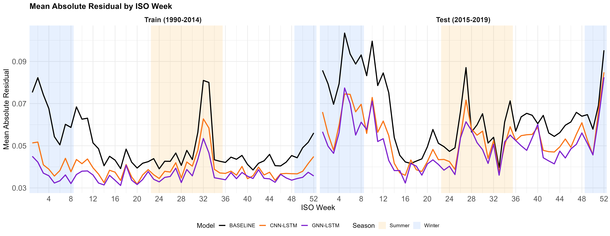

Kenrick is a **PhD researcher** at the Institute of Statistics, Biostatistics, and Actuarial Sciences in Université catholique de Louvain under the supervision of [Karim Barigou](https://karimbarigou.com/). His research focuses on developing **mathematical models to understand and manage uncertainty in financial, insurance, and climate markets.** In particular, his work explores the dependence between climate, financial, and insurance risks, incorporating climate data into stochastic models for pricing, forecasting, and risk management.

Kenrick holds a master's degree in applied mathematics, with a major in mathematical finance, from Ateneo de Manila University. His background includes quantitative risk management, stochastic modelling, and the development of mathematical tools to address uncertainty in finance and insurance. His research interests include **stochastic processes, neural networks, and their applications to forecasting, pricing, and hedging problems.**

Building on this foundation, his doctoral research examines how climate risks can be incorporated into financial and actuarial models. Physical climate shocks can affect insurance and financial markets simultaneously, while transition risks emerge as policy, technology, and economic activity evolve. These interconnected risks challenge traditional approaches that model climate, financial, and insurance factors separately. His work aims to develop unified modelling frameworks that account for these dependencies and provide practical tools for insurers and financial institutions to assess and manage emerging risks.

 
# Research Papers

  <strong>Climate-Driven Mortality Forecasting Using Deep Learning</strong> 
  <em>Working Paper.</em> 
  <a href="https://arxiv.org/abs/2606.26980">[Read here]</a>

We propose a two-step modelling framework that combines a regional weekly Lee--Carter baseline model that captures long-term mortality trends and overall seasonal patterns, with two complementary deep learning architectures designed to model excess mortality driven by environmental conditions and climate shocks. The first, a CNN--LSTM, captures region-specific temporal responses through convolutional filters. The second, a GNN--LSTM, replaces convolutions with graph-based representations to model spatial mortality dependencies and the propagation of climate-related impacts across regions. Both architectures are further extended to a quantile LSTM framework that produces time-varying prediction intervals. We evaluate our models against both the Lee--Carter baseline and MortFCNet. Using French regional data over 1990--2019, our models capture delayed and nonlinear associations between environmental extremes and excess mortality.

  <strong>Uncertainty in Pricing and Risk Measurement of Survivor Contracts</strong> 
  <em>Risks, vol. 13, no. 2, 2025.</em> 
  <a href="https://doi.org/10.3390/risks13020035">[Read here]</a>

As life expectancy rises, pension plans face increasing longevity risk. Survivor contracts, a type of longevity-linked security, allow these plans to transfer risk to capital markets. However, there is still debate over the best mortality models and premium principles for pricing these contracts. This paper examines how different modeling choices affect the pricing and risk measurement of survivor contracts. We present a framework for evaluating risk using various mortality models and premium principles, and analyze their impact on key risk measures such as value-at-risk and expected shortfall. Our findings highlight the importance of refining both mortality models and premium principles to improve pricing accuracy and risk management. We also recommend that practitioners use expected shortfall alongside value-at-risk to better capture tail risks and guide capital allocation.

